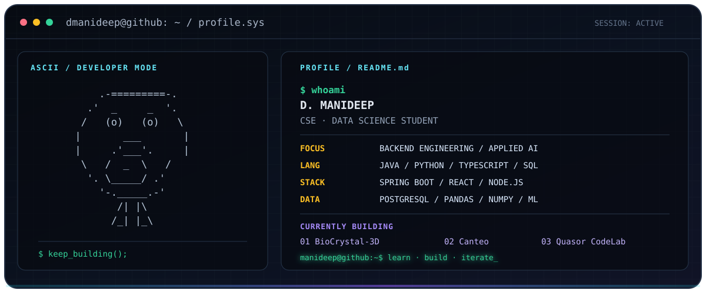

<!--
  D. MANIDEEP | TERMINAL-STYLE DEVELOPER PROFILE
  Real projects • Current learning • Verified public repositories
-->

<div align="center">



<br/>

<a href="https://github.com/dmanideep47-cpu?tab=repositories">
  
</a>
<a href="mailto:dmanideep47@gmail.com">
  
</a>

</div>

---

## `[01] ./whoami`

```text
manideep@github:~$ whoami

D. Manideep
CSE — Data Science Student

Interested in:
  > Backend Engineering
  > Data Science & Machine Learning
  > Applied AI and RAG systems

Current direction:
  Java + Spring Boot + SQL
  Python + ML + LLM applications
```

I'm learning to build useful software by connecting **backend engineering, data, and applied AI**. I enjoy taking projects from an idea through implementation, testing, and documentation.

## `[02] ./current-focus`

```text
┌──────────────────────────── CURRENT FOCUS ────────────────────────────┐
│  JAVA / DSA       Strengthening programming and problem-solving       │
│  SPRING BOOT      Learning backend services and REST APIs             │
│  SQL / DATABASES  Practising queries, schema design, PostgreSQL       │
│  PYTHON / ML      Data analysis, statistics, scikit-learn             │
│  APPLIED AI       Embeddings, LLMs, retrieval-augmented generation     │
└───────────────────────────────────────────────────────────────────────┘
```

Long-term direction: **Agentic AI Engineer**, built on strong software engineering and data foundations.

---

## `[03] ./projects --featured`

A selection of public projects. Open each repository for its implementation, setup instructions, and current scope.

<table>
<tr>
<td width="50%" valign="top">

### 🧬 [BioCrystal-3D](https://github.com/dmanideep47-cpu/BioCrystal-3D)

Interactive computational biology project for exploring DNA sequences, mutation effects, sequence comparison, and 3D molecular visualization.

`React` `TypeScript` `Three.js` `Python` `FastAPI` `Biopython`

</td>
<td width="50%" valign="top">

### 🍽️ [Canteo](https://github.com/dmanideep47-cpu/canteo)

College canteen ordering platform paired with an interactive Operating Systems synchronization lab covering bounded-buffer producer-consumer concepts.

`React` `TypeScript` `Java` `Spring Boot` `PostgreSQL`

</td>
</tr>
<tr>
<td width="50%" valign="top">

### ⚡ [Quasor CodeLab](https://github.com/dmanideep47-cpu/quasar-ai)

Learning-focused coding workspace exploring AI-assisted mentoring and retrieval-augmented generation over programming learning material.

`Next.js` `React` `TypeScript` `Tailwind CSS` `PostgreSQL/pgvector`

</td>
<td width="50%" valign="top">

### 🧪 [Learning & Practice](https://github.com/dmanideep47-cpu?tab=repositories)

Browse my public repositories for coding experiments, coursework, and ongoing practice.

`Java` `Python` `Web Development` `Data Science`

</td>
</tr>
</table>

---

## `[04] ./stack --list`

<div align="center">

**LANGUAGES**


**FRAMEWORKS & BACKEND**


**DATA & APPLIED AI**


**TOOLS & DATABASES**


</div>

<sub>These are technologies I use or am actively learning; the badges do not imply equal proficiency in every tool.</sub>

---

## `[05] ./learning-roadmap`

```text
PROGRAMMING        Java · OOP · DSA · SQL
       |
       v
BACKEND            Spring Boot · REST APIs · PostgreSQL
       |
       v
DATA & ML          Python · NumPy · pandas · Statistics · scikit-learn
       |
       v
APPLIED AI         Embeddings · LLMs · RAG · Retrieval Evaluation
       |
       v
INTELLIGENT APPS   Tool Use · Agent Workflows · Testing · Deployment
```

- [ ] Strengthen DSA and problem-solving with Java.
- [ ] Build and test backend services with Spring Boot.
- [ ] Improve SQL and relational database design.
- [ ] Complete end-to-end data analysis and ML workflows.
- [ ] Build grounded RAG applications and evaluate retrieval quality.
- [ ] Deploy projects with reproducible setup instructions.

---

## `[06] ./github-stats`

<div align="center">

<a href="https://github.com/dmanideep47-cpu">
  
</a>
<a href="https://github.com/dmanideep47-cpu?tab=repositories">
  
</a>

<br/><br/>

<a href="https://github.com/dmanideep47-cpu">
  
</a>

<br/><br/>

<a href="https://github.com/dmanideep47-cpu">
  
</a>

</div>

<sub>External statistics cards can be delayed or temporarily unavailable. Language cards reflect repositories GitHub can analyze, and may not represent private work.</sub>

### Contribution snake

<div align="center">
  <picture>
    <source media="(prefers-color-scheme: dark)" srcset="https://raw.githubusercontent.com/dmanideep47-cpu/dmanideep47-cpu/output/github-contribution-grid-snake-dark.svg" />
    <source media="(prefers-color-scheme: light)" srcset="https://raw.githubusercontent.com/dmanideep47-cpu/dmanideep47-cpu/output/github-contribution-grid-snake.svg" />
    
  </picture>
</div>

---

## `[07] ./contact`

```bash
$ echo "Learn deeply. Build deliberately. Keep improving."
```

<div align="center">

<a href="mailto:dmanideep47@gmail.com">
  
</a>
<a href="https://github.com/dmanideep47-cpu?tab=repositories">
  
</a>

<br/><br/>


**manideep@github:~$ keep_building --keep_learning**

</div>
