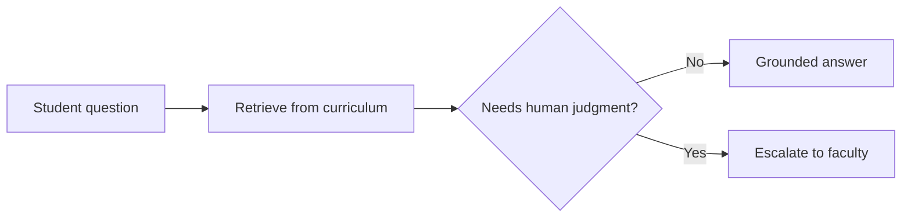

**CSE (Data Science) undergrad building AI products that retrieve, reason, and stay grounded in real data.**
I pair **LLMs + RAG** with solid **Java / Spring Boot** backend engineering, because good AI needs good software underneath.

<p>
  <a href="https://www.linkedin.com/in/dolla-manideep-b886bb435"></a>
  <a href="mailto:dmanideep47@gmail.com"></a>
  <a href="https://github.com/dmanideep47-cpu?tab=repositories"></a>
</p>

```python
class Manideep:
    role     = "AI/ML & Backend Developer (student)"
    building = ["EduResolve", "Quasar CodeLab"]
    stack    = ["Python", "Java", "Spring Boot", "PostgreSQL + pgvector", "Next.js"]
    learning = ["LangGraph", "retrieval evaluation", "PyTorch"]
    goal     = "Agentic AI Engineer"
```

---

## ⚡ Flagship Work

### 🎓 EduResolve · *AI academic doubt-resolution platform* · `In Development`
Students get answers grounded in curriculum material. Questions that need human judgment are escalated to faculty instead of guessed at.



`RAG` `LLM Integration` `Agentic AI` `Retrieval Quality`

### ⚡ [Quasar CodeLab](https://github.com/dmanideep47-cpu/quasar-ai) · *RAG learning workspace for Python* · `In Progress`
Answers Python questions from learning material with source-aware responses.

`RAG` `PostgreSQL / pgvector` `Next.js` `TypeScript` · **[View repository →](https://github.com/dmanideep47-cpu/quasar-ai)**

### Up next

| Project | What it is | Stack | Status |
|---|---|---|---|
| **Study Notes API** | Secure REST API to create, organize, and search notes | Java, Spring Boot, PostgreSQL, Docker | Planned |
| **AI Note Summarizer** | Turns notes into summaries, key points, and flashcards | Python, FastAPI, LLM APIs | Planned |

<sub>Only public, documented work is shown as finished. Everything else is labelled honestly.</sub>

---

## 🧰 Stack

<p>
  
</p>

---

## 🧭 Roadmap

```text
Python + Data → ML → Deep Learning → LLMs + RAG → Agents (LangGraph) → Production AI
      ✅          ✅        🔄              🔄              ⏳                 ⏳
```

<details>
<summary><b>2026–27 goals</b></summary>

- [ ] Solve DSA consistently in Java
- [ ] Complete Spring Boot + PostgreSQL + Docker backend
- [ ] End-to-end Machine Learning project
- [ ] Deep Learning project with PyTorch
- [ ] RAG application with PostgreSQL / pgvector
- [ ] Tool-using AI agent with memory and guardrails
- [ ] Deploy an AI-powered full-stack app
- [ ] Keep every repository clean, documented, and public

</details>

---

## 📈 Activity

<p align="center">
  
  
</p>

<picture>
  <source media="(prefers-color-scheme: dark)" srcset="https://raw.githubusercontent.com/dmanideep47-cpu/dmanideep47-cpu/output/github-contribution-grid-snake-dark.svg" />
  <source media="(prefers-color-scheme: light)" srcset="https://raw.githubusercontent.com/dmanideep47-cpu/dmanideep47-cpu/output/github-contribution-grid-snake.svg" />
  
</picture>

---

<p align="center"><b>Learn deeply · Build deliberately · Ship publicly</b></p>
