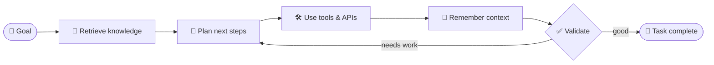
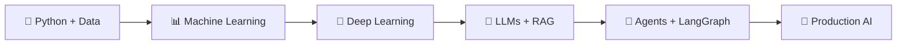

<!-- ═══════════════════════════════════════════════════════════
     D MANIDEEP — AI/ML & BACKEND DEVELOPER
     ═══════════════════════════════════════════════════════════ -->

<div align="center">


### 🚀 Building intelligent systems with **Java**, **Python** and **Data**

<a href="https://readme-typing-svg.demolab.com">
  
</a>

<br/><br/>

<a href="https://github.com/dmanideep47-cpu?tab=repositories">
  
</a>
<a href="mailto:dmanideep47@gmail.com">
  
</a>
<a href="https://www.linkedin.com/in/dolla-manideep-b886bb435">
  
</a>

<br/>


</div>

---

## 👋 Hi, I’m Manideep

I’m a **CSE–Data Science undergraduate** passionate about building AI-powered products that are **useful, reliable, and grounded in real data**.

I combine **Machine Learning, LLMs, RAG, and backend engineering** to build systems that do more than generate text — systems that **retrieve knowledge, use tools, remember context, and solve real problems.**

<table>
<tr>
<td width="50%" valign="top">

### 🔭 Right now

- 🚧 Building **EduResolve** and **Quasar CodeLab**
- 📚 Learning **LangGraph**, retrieval evaluation, and **PyTorch**
- ☕ Sharpening **Java + Spring Boot** backend skills
- 🧩 Practicing **DSA in Java**

</td>
<td width="50%" valign="top">

### 🎯 Aiming to become

```text
Agentic AI Engineer
 = AI/ML (how intelligence works)
 + Backend (how software scales)
```

</td>
</tr>
</table>

> 💡 *My goal is to build AI products that are accurate, useful, testable, and safe enough for real users.*

---

## 🧠 What I Work On

| Area | Focus |
|---|---|
| 🤖 **AI / ML** | Python, NumPy, pandas, scikit-learn, PyTorch, LLMs, RAG, and agents |
| ☕ **Backend** | Java, Spring Boot, REST APIs, authentication, PostgreSQL, Docker |
| 🗄️ **Data Engineering** | SQL, database design, data pipelines, embeddings, and vector search |

### The kind of systems I’m working toward



---

## 🛠️ Tech Stack

<div align="center">

### 👨‍💻 Languages


### 🤖 AI / ML


### ☕ Backend, Web & Data


### 🧰 Tools & DevOps


</div>

---

## 📌 Featured Projects

> I’m building a portfolio of complete, public, well-documented projects across AI/ML and backend engineering.

<table>
<tr>
<td width="50%" valign="top">

### 🎓 EduResolve
**AI-powered academic doubt-resolution platform**

Students get grounded answers from curriculum material using retrieval-augmented generation. Questions that need human judgment are escalated to faculty.

`Agentic AI` · `RAG` · `LLM Integration` · `Retrieval Quality`


<!-- Add public repository link when ready -->

</td>
<td width="50%" valign="top">

### ⚡ [Quasar CodeLab](https://github.com/dmanideep47-cpu/quasar-ai)
**AI-assisted coding and learning workspace**

Answers questions from Python learning material with grounded, source-aware responses using RAG.

`RAG` · `PostgreSQL/pgvector` · `Next.js` · `TypeScript`


[](https://github.com/dmanideep47-cpu/quasar-ai)

</td>
</tr>
<tr>
<td width="50%" valign="top">

### ☕ Study Notes API
**Secure backend for intelligent note management**

Spring Boot REST API to create, organize, search, and manage study notes with PostgreSQL persistence and Docker deployment.

`Java` · `Spring Boot` · `REST API` · `PostgreSQL` · `Docker`


<!-- Add repository link when public -->

</td>
<td width="50%" valign="top">

### 🤖 AI Note Summarizer
**LLM-powered study assistant service**

Python FastAPI service that turns study notes into concise summaries, key points, and flashcards using LLM APIs and structured output.

`Python` · `FastAPI` · `LLM APIs` · `Prompt Engineering` · `PostgreSQL`


<!-- Add repository link when public -->

</td>
</tr>
</table>

<sub>I only present public, documented work as finished. Everything else is labelled honestly.</sub>

---

## 🧪 AI/ML Learning Path



<div align="center">

| Stage | Skills | Outcome |
|:-:|---|---|
| 1 | Python, NumPy, pandas, Jupyter | Data analysis and manipulation |
| 2 | Statistics, probability, linear algebra | ML mathematical intuition |
| 3 | scikit-learn | Classical ML models and evaluation |
| 4 | PyTorch, CNNs, transfer learning | Deep learning projects |
| 5 | LLM APIs, prompting, embeddings | AI-powered applications |
| 6 | RAG, pgvector, retrieval evaluation | Grounded AI systems |
| 7 | Tools, memory, LangGraph | Agentic AI systems |
| 8 | Docker, APIs, deployment | Production-ready AI products |

</div>

---

## 🎯 2026–27 Goals

- [ ] Solve DSA consistently in Java
- [ ] Build a complete Spring Boot + PostgreSQL + Docker backend
- [ ] Build an end-to-end Machine Learning project
- [ ] Build a Deep Learning project using PyTorch
- [ ] Build a RAG application using PostgreSQL/pgvector
- [ ] Build a tool-using AI agent with memory and guardrails
- [ ] Deploy an AI-powered full-stack application
- [ ] Maintain clean GitHub repositories with strong documentation

---

## 📈 GitHub Activity

<div align="center">


<br/>


<br/>


<sub>Stats come from external services and may occasionally be unavailable. Language cards reflect public repositories only.</sub>

</div>

---

## 🐍 Contribution Snake

<div align="center">

<picture>
  <source media="(prefers-color-scheme: dark)" srcset="https://raw.githubusercontent.com/dmanideep47-cpu/dmanideep47-cpu/output/github-contribution-grid-snake-dark.svg" />
  <source media="(prefers-color-scheme: light)" srcset="https://raw.githubusercontent.com/dmanideep47-cpu/dmanideep47-cpu/output/github-contribution-grid-snake.svg" />
  
</picture>

</div>

---

## 📫 Let’s Connect

<div align="center">

Open to collaborating on **AI/ML** and **backend** projects — say hi!

<a href="https://www.linkedin.com/in/dolla-manideep-b886bb435">
  
</a>
<a href="mailto:dmanideep47@gmail.com">
  
</a>
<a href="https://github.com/dmanideep47-cpu">
  
</a>

<br/><br/>

### **Learn deeply. Build deliberately. Ship publicly. Improve relentlessly.**


</div>
